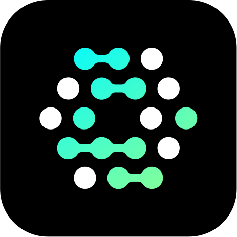

# Hi 👋 I'm Léo Nonnenmacher

**Platform Engineer & MLOps** at [Cloudeo](https://www.cloudeo.fr) · trainer · CEO of [Retake](https://retake.fr)

I build cloud and AI infrastructure with a frugal approach (a lot with little, kept secure) and I take apart hardware that was declared dead until it works again.

- 🌍 Based in Strasbourg
- 🚀 Building [Phorge](https://github.com/phorge-fr), an open-source, self-hostable cloud provider
- 🧠 Exploring Crossplane and Upjet providers, LLMs on unusual NPUs and GPUs, and GitOps at homelab scale
- ✉️ [leo@nonnenmacher-logel.fr](mailto:leo@nonnenmacher-logel.fr) · [Blog](https://leo.nonnenmacher-logel.fr) · [LinkedIn](https://www.linkedin.com/in/l%C3%A9o-nonnenmacher/) · [Retake](https://retake.fr)

## Phorge

Every line of configuration, automation and infrastructure logic is public. The roadmap is a [public GitHub project](https://github.com/orgs/phorge-fr/projects/3).

| Repository | What it holds |
| --- | --- |
| [Hangar](https://github.com/phorge-fr/Hangar) | GitOps (Flux) for the Kubernetes clusters: manifests, Crossplane compositions, docs |
| [Network](https://github.com/phorge-fr/Network) | Router configuration as code with OpenTofu |
| [Ansible](https://github.com/phorge-fr/Ansible) | Roles and playbooks for everything that is not Kubernetes |
| [phorge-api](https://github.com/phorge-fr/phorge-api) | The Phorge API: tenants, images, instances, memberships and API keys |

### Crossplane providers

Generated with [Upjet](https://github.com/crossplane/upjet), to manage Phorge's building blocks from Kubernetes.

- [provider-incus](https://github.com/l-nmch/provider-incus): Incus, from lxc/terraform-provider-incus
- [provider-openfga](https://github.com/l-nmch/provider-openfga): OpenFGA, from openfga/terraform-provider-openfga
- [provider-authentik](https://github.com/l-nmch/provider-authentik): authentik

## AI, NPU and homelab

- [hailo-10h-llm-compiler](https://github.com/l-nmch/hailo-10h-llm-compiler): compile your own LLM for the Hailo-10H, from a Hugging Face checkpoint to a self-contained HEF
- [hailo-mnist](https://github.com/l-nmch/hailo-mnist): train a model and deploy it on a Hailo-8L NPU
- [benchy-graph](https://github.com/l-nmch/benchy-graph): display llama-benchy results as graphs
- [GladoCam](https://github.com/l-nmch/GladoCam): real-time face tracking with OpenCV and an ESP8266

More on the [blog](https://leo.nonnenmacher-logel.fr): [LLMs on a Hailo-10H](https://leo.nonnenmacher-logel.fr/en/posts/hailo10h-llm-compile/) and [training an LLM from scratch on a 2020 GPU](https://leo.nonnenmacher-logel.fr/en/posts/llm-from-scratch-t10/).

## Stack

## Activity

Generated daily by [lowlighter/metrics](https://github.com/lowlighter/metrics) from [this workflow](.github/workflows/metrics.yml), nothing external to fail.

